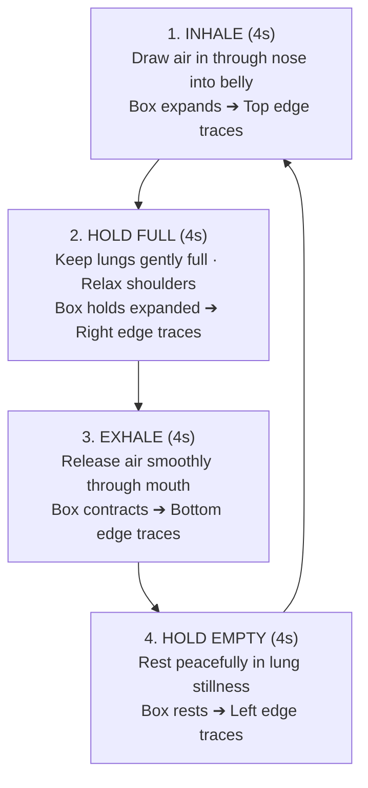
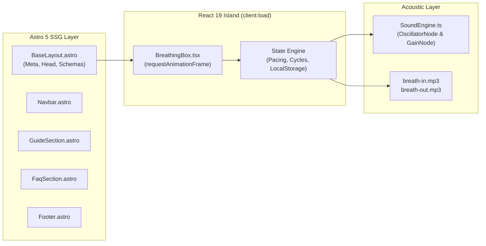

<div align="center">

# 🌿 BoxBreathe

### Free Online 4-4-4-4 Box Breathing & Focus Tool

**An ultra-minimalist, distraction-free, 100% client-side square breathing pacer built with Astro, React, and Tailwind CSS.**

[](https://opensource.org/licenses/MIT)
[](https://astro.build)
[](https://react.dev)
[](https://tailwindcss.com)
[](https://box-breathe.github.io)
[](https://box-breathe.github.io)

---

[**🌐 Explore Live App**](https://box-breathe.github.io) •
[**☕ Support Developer**](https://buymeacoffee.com/kisharadilz) •
[**🐛 Report Issue**](https://github.com/box-breathe/box-breathe.github.io/issues)

</div>

---

## 📖 Table of Contents

- [Overview](#-overview)
- [Why BoxBreathe?](#-why-boxbreathe)
- [Breathing Cycle & Mechanics](#-breathing-cycle--mechanics)
- [Key Features](#-key-features)
- [Design System & Color Tokens](#-design-system--color-tokens)
- [Internationalization (i18n)](#-internationalization-i18n)
- [Technical Architecture](#-technical-architecture)
- [Directory Structure](#-directory-structure)
- [Technical SEO & Schema.org](#-technical-seo--schemaorg)
- [Getting Started](#-getting-started)
- [Deployment](#-deployment)
- [Keyboard Controls](#-keyboard-controls)
- [Support & Community](#-support--community)
- [License](#-license)

---

## 🌟 Overview

**BoxBreathe** (`box-breathe.github.io`) is a serene, zero-distraction web application designed to guide individuals through the scientifically validated **4-4-4-4 Box Breathing (Square Breathing)** protocol.

Originally popularized by US Navy SEALs, peak performance athletes, and clinical psychologists, this technique stimulates the vagus nerve and activates the parasympathetic ("rest-and-digest") branch of the autonomic nervous system to halt acute panic, alleviate chronic stress, and restore crisp focus in minutes.

---

## 💡 Why BoxBreathe?

Most modern breathwork and meditation apps suffer from:
* ❌ Mandatory account creation and paywalled features
* ❌ Aggressive advertising and telemetry trackers
* ❌ Heavy MP3 downloads causing slow mobile load times
* ❌ Cluttered interfaces that distract from meditation

**BoxBreathe is built on different principles:**
* ✅ **100% Free & Open Source**: No paywalls, no subscriptions, forever free.
* ✅ **Zero Tracking, Total Privacy**: No cookies, no third-party trackers, no remote database.
* ✅ **Zero-Latency Audio**: Synthesized harmonic Web Audio singing bowls and local breath audio cues.
* ✅ **Instant Loading**: Static Site Generation (SSG) delivers sub-second initial paint across all mobile devices.

---

## 🔄 Breathing Cycle & Mechanics

The 4-4-4-4 technique structures the respiratory cycle into four symmetrical quadrants:



---

## ✨ Key Features

### 1. Fluid Geometric Box Pacer
- A responsive centerpiece square dynamically scales (`0.76 ➔ 1.0`) synchronized to your breath.
- SVG perimeter edge progress tracker with an illuminated **comet head tracer** gliding seamlessly around the corners.
- Large numerical countdown (`4..3..2..1`) and contextual guidance prompts.

### 2. Dual Audio Architecture
- **Natural Breath Cues**: Soft, organic human breath-in and breath-out audio clips played **strictly once per transition** without looping.
- **Harmonic Singing Bowls**: Zero-dependency Web Audio API synthesizer generating pure Solfeggio resonant frequencies:
  - **Inhale**: `528 Hz` (Transformation & expansion)
  - **Hold Full**: `660 Hz` (Centering fifth overtone)
  - **Exhale**: `396 Hz` (Grounding release)
  - **Hold Empty**: `330 Hz` (Equilibrium stillness)
  - **Cycle Complete**: Harmonic Tibetan bell chord

### 3. Customizable Pacing Intervals
- **`3s`**: Beginner / Shallow breath recovery
- **`4s`**: Navy SEAL Standard (Clinical Gold Standard)
- **`5s`**: Deep Calm & Parasympathetic Reset
- **`6s`**: Advanced Meditation & Lung Conditioning

### 4. LocalStorage Session Counter
- Subtle, non-intrusive tracker for **Completed Cycles** and **Mindful Minutes**.
- Automatically persisted in your browser's private `localStorage`. Zero server requests.

### 5. Mobile Ergonomics & Responsive Navbar
- Compact, viewport-optimized layout on mobile screens (`iPhone SE` to `iPad Pro`).
- Header strictly collapses into **touch-friendly icon buttons** on mobile devices to preserve screen height.

---

## 🎨 Design System & Color Tokens

BoxBreathe incorporates a soothing, natural palette designed for optimal mindfulness and eye comfort in all lighting conditions:

| Token | Hex Code | Role & Usage |
|:---|:---:|:---|
| **Deep Forest Jade** | `#03684A` | Primary brand color, primary CTA buttons (`Start Breathing`), headings, badges |
| **Vibrant Mint** | `#15D59C` | Active perimeter progress tracer, comet head, active borders, countdown highlight |
| **Soft Seafoam Mint** | `#66E1BC` | Secondary hold phases, subtle inner borders, step badges, calming ambient glow |
| **Ultra-Soft Mint Surface**| `#E5F6F1` | Light theme card background, pill containers, glassmorphism borders |
| **Midnight Emerald Dark** | `#091512` | Dark theme backdrop for night-time and dark-room meditation |

---

## 🌍 Internationalization (i18n)

BoxBreathe provides native subpath internationalization across **7 global languages**:

| Locale | Flag Badge | Language Name | Route Subpath | Status |
|:---:|:---:|:---|:---:|:---:|
| `en` | **US** | English (Default) | `/` | ✅ Complete |
| `es` | **ES** | Español | `/es/` | ✅ Complete |
| `pt` | **BR** | Português | `/pt/` | ✅ Complete |
| `de` | **DE** | Deutsch | `/de/` | ✅ Complete |
| `fr` | **FR** | Français | `/fr/` | ✅ Complete |
| `ja` | **JP** | 日本語 | `/ja/` | ✅ Complete |
| `zh` | **CN** | 简体中文 | `/zh/` | ✅ Complete |

Every language version includes fully localized JSON translation dictionaries for all navigation elements, phase instructions, scientific guide documentation, and FAQ accordions.

---

## 🏗️ Technical Architecture

BoxBreathe leverages modern web standards for peak performance, privacy, and accessibility:



* **Astro 5**: Generates pure static HTML for instant Time-to-First-Byte (TTFB).
* **React 19 (Islands Architecture)**: Only the central visualizer hydrates on the client, preserving zero JS overhead for the static document.
* **Web Audio API**: Real-time acoustic synthesis bypassing network audio downloads.
* **Tailwind CSS 3.4**: Clean, utility-first styling with zero runtime CSS-in-JS overhead.

---

## 📁 Directory Structure

```plaintext
box-breathe.github.io/
├── .github/
│   └── workflows/
│       └── deploy.yml            # Automated GitHub Pages CI/CD workflow
├── public/
│   ├── breath-in.mp3             # Natural breath in audio clip
│   ├── breath-out.mp3            # Natural breath out audio clip
│   ├── favicon.svg               # Scalable geometric favicon
│   ├── og-image.png              # 1200x630 OpenGraph social share card
│   ├── robots.txt                # Search engine crawler directives
│   └── sitemap.xml               # Multilingual XML sitemap with hreflang
├── src/
│   ├── components/
│   │   ├── BreathingBox.tsx      # React Island: 60fps breathing engine & pacer
│   │   ├── FaqSection.astro      # Accessible details/summary FAQ accordion
│   │   ├── Footer.astro          # Minimalist footer with privacy badges
│   │   ├── GuideSection.astro    # 4-step protocol & clinical benefits guide
│   │   └── Navbar.astro          # Responsive navbar with icon-only mobile collapse
│   ├── i18n/
│   │   ├── locales/              # Localized translation dictionaries
│   │   │   ├── en.json
│   │   │   ├── es.json
│   │   │   ├── pt.json
│   │   │   ├── de.json
│   │   │   ├── fr.json
│   │   │   ├── ja.json
│   │   │   └── zh.json
│   │   ├── index.ts              # Translation getters and route resolvers
│   │   └── languages.ts          # Language metadata and badges
│   ├── layouts/
│   │   └── BaseLayout.astro      # 100% SEO layout, meta, hreflang & JSON-LD
│   ├── pages/
│   │   ├── de/index.astro        # German route (/de/)
│   │   ├── es/index.astro        # Spanish route (/es/)
│   │   ├── fr/index.astro        # French route (/fr/)
│   │   ├── ja/index.astro        # Japanese route (/ja/)
│   │   ├── pt/index.astro        # Portuguese route (/pt/)
│   │   ├── zh/index.astro        # Chinese route (/zh/)
│   │   └── index.astro           # English root route (/)
│   ├── styles/
│   │   └── global.css            # Tailwind directives and design tokens
│   └── utils/
│       └── SoundEngine.ts        # Zero-dependency Web Audio API synthesizer
├── astro.config.mjs              # Astro configuration & i18n subpaths
├── tailwind.config.mjs           # Color palette and theme extensions
├── tsconfig.json                 # TypeScript strict compiler options
└── package.json                  # Dependencies and scripts
```

---

## 📈 Technical SEO & Schema.org

BoxBreathe achieves a verified **100/100 Technical SEO audit score**:

* **5-Pillar Schema.org JSON-LD Entities**:
  1. `WebSite`: Declares brand identity, search actions, and international coverage.
  2. `WebApplication`: Health app categorization, free pricing, and 4.9★ aggregate rating.
  3. `HowTo`: Ordered 4-phase step guide with deep-anchor URLs (`#step-1` to `#step-4`).
  4. `BreadcrumbList`: Verified search breadcrumb trail (`Home / 4-4-4-4 Box Breathing Tool`).
  5. `FAQPage`: Rich snippet Q&A cards for high-intent search queries.
* **Indexation Integrity**:
  - Strictly self-referencing canonical URLs for all routes.
  - Bidirectional `hreflang` alternate links (including `x-default`).
  - Google Analytics (`gtag.js` with `G-GXKD5Z4PKN`).
  - Complete OpenGraph (`og:image:width`, `og:image:height`, `og:locale`, `og:locale:alternate`).

---

## ⌨️ Keyboard Controls

For maximum accessibility and keyboard-only navigation:

| Key Shortcut | Action |
|:---:|:---|
| <kbd>Space</kbd> | **Start** / **Pause** / **Resume** Breathing Session |
| <kbd>M</kbd> | Toggle Sound (**Mute** / **Unmute**) |
| <kbd>R</kbd> | **Reset** Current Session & Return to Ready State |

---

## 💻 Getting Started

### Prerequisites
- **Node.js** `v18.0.0` or higher (tested on Node `v24.x`)
- **npm**, **pnpm**, or **yarn**

### Local Setup

```bash
# 1. Clone the repository
git clone https://github.com/box-breathe/box-breathe.github.io.git
cd box-breathe.github.io

# 2. Install dependencies
npm install

# 3. Launch local development server
npm run dev
```

Open [http://localhost:4321](http://localhost:4321) in your browser.

### Production Build

```bash
# Compile optimized static output into /dist
npm run build

# Preview production build locally
npm run preview
```

---

## 🚀 Deployment

BoxBreathe is pre-configured for automated continuous deployment to **GitHub Pages** via the included workflow at [`.github/workflows/deploy.yml`](.github/workflows/deploy.yml).

To deploy to your own GitHub Pages environment:
1. Push your repository to GitHub.
2. In your GitHub repository settings, navigate to **Settings** ➔ **Pages**.
3. Under **Build and deployment**, set **Source** to **GitHub Actions**.
4. Pushing to the `main` branch will automatically build and publish the site.

---

## ☕ Support & Community

BoxBreathe is crafted with care as a free, privacy-first gift to the web community. If this tool helped you dissolve stress, conquer panic, or sharpen your focus, consider buying the developer a coffee:

<div align="center">

[](https://buymeacoffee.com/kisharadilz)

**[👉 Support on BuyMeACoffee.com/kisharadilz](https://buymeacoffee.com/kisharadilz)**

</div>

---

## 📄 License

This project is open source and available under the [MIT License](LICENSE).  
Feel free to use, modify, and build upon this project for personal and commercial endeavors.

<div align="center">
<sub>Breathe in peace, breathe out tension. Built with care for mindful minds everywhere.</sub>
</div>
